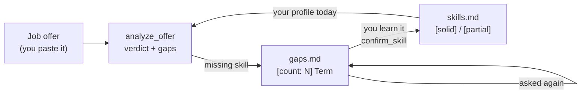

# job-radar-mcp

A local MCP server that lets your AI assistant screen job offers against a
detailed profile of **your** skills, and keeps a running radar of the skills the
market keeps asking for and you do not have yet. Everything lives in plain
Markdown files on your own machine.

## Why

Companies already use AI to filter candidates. It makes sense for candidates to
use AI to filter offers too: not against a generic idea of "a good job", but
against their own profile, their own goal and their own deal-breakers.

Reading an offer and asking "is this worth my time?" is easy to get wrong when
you are tired, hopeful or in a hurry. This project gives your AI assistant the
context to give you an honest answer, every time, and it remembers what each
offer asked for that you are missing. After twenty offers you no longer guess
what to learn next: the radar tells you.

## How it works

Two files sit at the heart of it, and they never overlap:

- **`skills.md`**: what you **already have**. Each skill is `[solid]` (you can
  defend it in an interview with evidence) or `[partial]` (you have used it, you
  do not master it). Gaps never live here.
- **`gaps.md`**: what offers ask for and you **do not have**. Each term carries a
  **counter** of how many offers asked for it. The higher the count, the more
  urgent it is to learn.

When you analyse an offer, every missing skill goes to the radar: a new term is
created with count 1, a known term goes up by one. When you actually acquire a
skill (a course, a project, real experience), you **graduate** it: it leaves the
radar and enters your profile with its level and the evidence. That is the only
way from gap to profile.



Each analysis ends with one of four verdicts (**good fit**, **reasonable
reach**, **too demanding**, **not worth the time**), concrete evidence from your
CV, the cheapest gap to close, the terms you should be able to define in an
interview, and what to highlight in your CV for that specific offer. The
analysis is saved in `offers/` and you can track each offer through its
lifecycle (`analyzed`, `applied`, `interview`, `offer`, `accepted`, or the side
exits `rejected` and `discarded`).

It can also render a one-page CV tailored to an offer (`render_cv`), choosing
only from content that already exists in your `cv-data.json`. It reorders and
trims, it never invents.

## What it does NOT do

- **No scraping.** It does not crawl job boards. You paste the offer text into
  your AI client.
- **No network, no database.** The server reads and writes Markdown files in a
  folder you choose. That is all.
- **No AI of its own.** The server does not think. Your AI client does the
  reasoning; this server is its memory and its hands.

## Your data stays yours

The idea and the data are personal. Each user builds their own vault: their
skills, their goal, their criteria, their offers. Nothing leaves your machine
except what your AI client sends to its own model when you use it.

This repository only contains **fictional data**: the `example-vault/` folder
belongs to Alex Morgan, a made-up junior developer from a made-up city. Copy it,
then replace everything with your own. Keep your real vault **outside** the repo
(the default location is `~/job-radar-vault`), and `.gitignore` will block the
usual names (`vault/`, `*-vault/`, `*.local.md`) if you put one inside by
mistake.

## Why MCP

[MCP (Model Context Protocol)](https://modelcontextprotocol.io) is an open
standard for connecting AI assistants to tools and data. Building this as an MCP
server means anyone can plug it into the AI client they already use (Claude
Desktop, Claude Code, or any other MCP-compatible client) without depending on
one specific app. Swap the client, keep your vault.

---

## Quick start

### 1. Requirements

- [Node.js](https://nodejs.org) 22 or newer.
- An MCP-compatible AI client, such as Claude Desktop or Claude Code.
- Optional: [Obsidian](https://obsidian.md), to browse and edit your vault
  comfortably. The vault is a plain folder of Markdown, so any editor works.

### 2. Install

```bash
git clone https://github.com/JonniThorpe/job-radar-mcp.git
cd job-radar-mcp
npm install
npm run build
```

### 3. Create your vault from the example

```bash
# macOS / Linux
cp -r example-vault ~/job-radar-vault
```

```powershell
# Windows (PowerShell)
Copy-Item -Recurse example-vault "$HOME\job-radar-vault"
```

Then open the copy and make it yours. Start with `profile/criteria.md` (your
career goal goes under `## Goal`) and `profile/skills.md`. Empty
`profile/gaps.md` down to its headings: the radar fills itself as you analyse
offers.

If the folder does not exist when the server starts, it tells you so on stderr,
keeps running, and every tool answers with instructions instead of silently
creating an empty vault.

### 4. Register the server in your client

It is a **stdio** server: the client launches it as a child process. Use the
**absolute** path to `build/index.js` and to your vault.

**Claude Code**

```bash
claude mcp add job-radar --scope user \
  -e JOB_MCP_DATA_DIR=/absolute/path/to/job-radar-vault \
  -- node /absolute/path/to/job-radar-mcp/build/index.js
```

**Claude Desktop**: add this block to `claude_desktop_config.json` (Settings >
Developer > Edit Config):

```json
{
  "mcpServers": {
    "job-radar": {
      "command": "node",
      "args": ["/absolute/path/to/job-radar-mcp/build/index.js"],
      "env": { "JOB_MCP_DATA_DIR": "/absolute/path/to/job-radar-vault" }
    }
  }
}
```

On Windows, write paths with double backslashes (`C:\\Users\\you\\...`). If
Claude Desktop cannot find `node`, use the absolute path to the Node executable
as `command`: desktop apps do not always inherit your terminal's `PATH`.

**Other clients**: any MCP client that supports stdio servers takes the same
three things: the command (`node`), the argument (the path to
`build/index.js`) and the environment variable `JOB_MCP_DATA_DIR`.

### 5. First use

1. Ask your assistant to run the `ping` tool. It answers with the data folder it
   is using.
2. Start the **`analyze_offer`** prompt. In Claude Code, type `/` and pick
   `/mcp__job-radar__analyze_offer`. In Claude Desktop, open the `+` menu and
   look for it under the `job-radar` server. Other clients list MCP prompts in
   their own way.
3. Paste the offer text below it and send.
4. Read the verdict. The assistant then saves the analysis with `save_offer` and
   records each missing skill with `record_gap`.
5. Open `profile/gaps.md` and watch the counters grow over the next offers.

> **Every `npm run build` requires restarting your client.** An MCP server over
> stdio is launched once, when the client starts, and that process stays alive.
> There is no hot reload. In Claude Desktop, closing the window is not enough:
> quit it from the system tray or menu bar. Typical symptom: you ask for a new
> tool and the client insists it does not exist.

---

## Reference

### Tools (the model calls them)

| Tool | What it does |
| --- | --- |
| `record_gap(term, category, source)` | Bumps a gap's count by one and adds the source. Creates it with count 1 if it is new. Never duplicates. |
| `list_gaps()` | Lists gaps sorted by count, most urgent first. |
| `confirm_skill(term, level, evidence, category?)` | Graduation: moves a skill from the radar to your profile. Only the evidence travels, not the sources. |
| `update_skill_level(term, level)` | Changes `solid` / `partial` for a skill already in your profile. |
| `save_offer(id, title, company, markdown, score?, salary?, url?, tags?)` | Creates or updates an offer. On update it keeps the status and interview notes. |
| `set_offer_status(id, status)` | Moves an offer along its lifecycle and logs the change with a date. |
| `add_offer_note(id, note)` | Adds a dated note under "Interview notes". |
| `render_cv(offerId, ...)` | Writes `output/cv-<id>.html`, a one-page CV tailored to an offer, using only content from `cv-data.json`. Warns if the page overflows. |
| `ping()` | Health check: says which data folder it uses, or what is wrong with it. |

### Resources (you attach them)

| URI | Content |
| --- | --- |
| `profile://skills` | `skills.md` |
| `profile://gaps` | `gaps.md`, sorted by count when served |
| `profile://cv` | `cv.md` |
| `profile://cv-data` | `cv-data.json`, the catalogue `render_cv` chooses from |
| `profile://criteria` | `criteria.md` |
| `offers://list` | The pipeline: status, company, title, score |
| `offers://{id}` | One full offer: analysis, status log and notes |

### Prompt (you start it)

| Prompt | What it does |
| --- | --- |
| `analyze_offer` | Returns the analysis template filled in with your skills, CV and criteria **read from disk at that moment**, including your goal from `criteria.md` (if it is missing, the assistant asks you for it first). Paste the offer below it. |

### Vault layout

```
job-radar-vault/
  profile/
    skills.md          - [solid|partial] Term (evidence)        under '## Category'
    gaps.md            - [count: N] Term (Category). Sources: a; b
    criteria.md        ## Goal, deal-breakers and scoring axes, in free prose
    cv.md              your CV in Markdown: evidence for the analysis
    cv-data.json       your CV split into ids: what render_cv may use
    interview-prep.md  blank template for STAR stories (not read by the server)
  offers/
    YYYY-MM-company.md YAML frontmatter + analysis + status log + notes
  output/
    cv-<id>.html       generated, never edit by hand
```

**The server never regenerates a file.** It parses only the lines it recognises
(by pattern, such as `- [count: N] `) and edits that exact line, leaving every
other byte untouched. That is why you can write your own notes, rules and prose
around the data lines, in Obsidian or any editor. The format is yours, not the
server's.

### Obsidian (optional)

The vault works well as an Obsidian vault. Two community plugins pair nicely
with it: **Dataview** (live tables of the radar and of offers by status, from
the frontmatter) and **Kanban** (the offer pipeline as a board).

### Configuration

| Variable | Default |
| --- | --- |
| `JOB_MCP_DATA_DIR` | `~/job-radar-vault` |

---

## Development

```bash
npm run build   # tsc -> build/
npm test        # tsc + node --test
npm run watch   # rebuild on save
```

```
src/
  index.ts             wiring only: resources + tools + prompts + stdio transport
  config.ts            data folder and derived paths
  resources.ts         the 7 resources
  tools.ts             the 9 tools, with their Zod schemas
  prompts.ts           analyze_offer
  lib/
    analysis-prompt.ts the analysis template and the goal reader
    markdown.ts        line-level primitives: headings, sections, EOL
    skills.ts          skills.md
    radar.ts           gaps.md and its counters
    offers.ts          frontmatter, statuses and notes
    graduate.ts        confirm_skill: the operation that spans both files
    cv.ts              render_cv: selection, height estimate, HTML
    files.ts           the ONLY module that touches the disk
templates/
  cv.html              CV design
example-vault/         fictional data, also used by the tests
```

`src/lib/*` are pure functions shaped like `(content, args) -> { content,
changed, message }`, so the tests never touch your vault and run in a fraction
of a second. Comments in the source are in Spanish; everything user-facing is in
English.

**Never use `console.log` in the server.** stdout is the JSON-RPC channel and
writing to it breaks the protocol. Logs go to `console.error` (stderr).

You can talk to the server without any client by piping raw JSON-RPC:

```bash
printf '%s\n' \
  '{"jsonrpc":"2.0","id":1,"method":"initialize","params":{"protocolVersion":"2025-06-18","capabilities":{},"clientInfo":{"name":"cli","version":"0"}}}' \
  '{"jsonrpc":"2.0","method":"notifications/initialized"}' \
  '{"jsonrpc":"2.0","id":2,"method":"tools/list"}' \
  | JOB_MCP_DATA_DIR=./example-vault node build/index.js
```

Running it against `example-vault` writes to it, so try things on a copy.

## Contributing

Issues and pull requests are welcome. Ideas that are already on the table live
in [ROADMAP.md](ROADMAP.md); open an issue to discuss before building a large
change. Please keep `npm test` green, add tests for new behaviour in
`src/lib`, and never commit real personal data: test fixtures and
`example-vault/` must stay fictional.

## License

[MIT](LICENSE)
